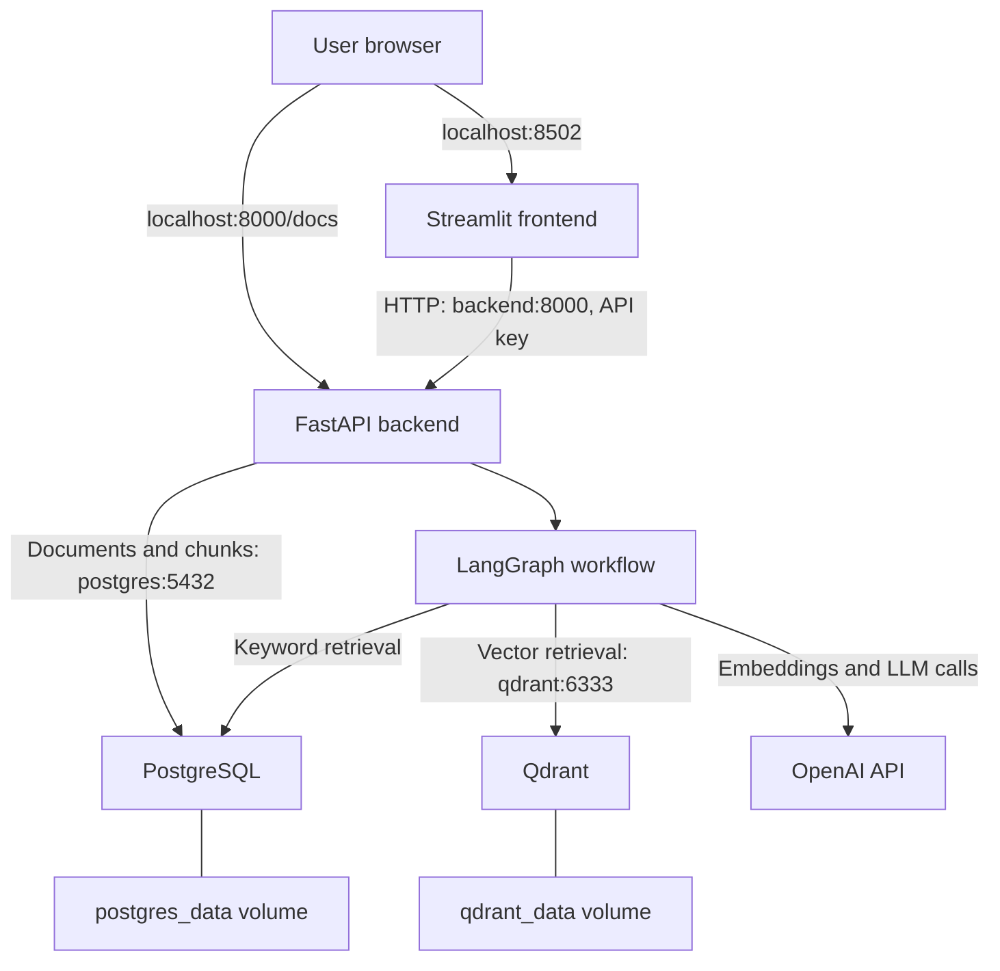
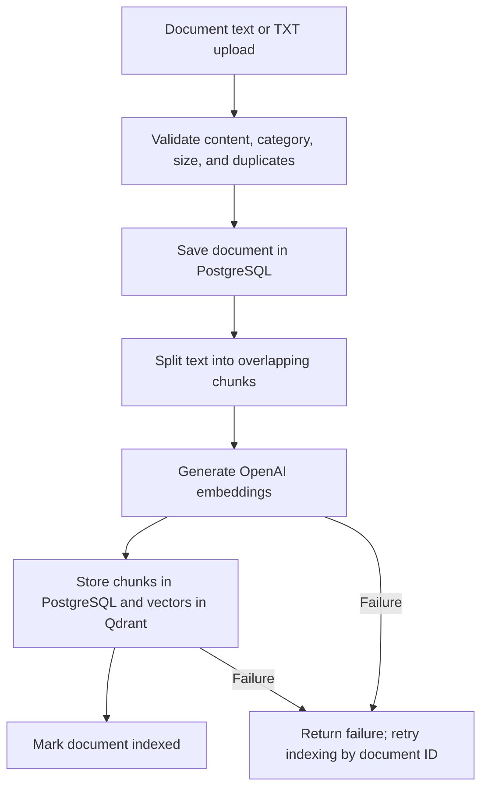
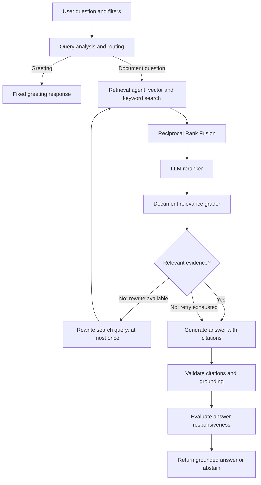

# Application Architecture

## Running services and storage



The browser connects through published host ports.
Containers communicate using Docker service names and internal ports.

OpenAI is an external service. PostgreSQL and Qdrant store data in
persistent Docker volumes.

## Document ingestion



PostgreSQL and Qdrant updates are not one distributed transaction.
A saved document may remain unindexed after a failure.
The indexing endpoint supports retrying that document.

## Agentic question-answering workflow



The original question remains unchanged when the search query is rewritten.

If no evidence remains, generation returns an abstention.
Unsupported or unresponsive answers are also withheld.
There is no additional generation-retry loop after grounding failure.

## Reliability and security

- Pydantic request validation
- Shared API key supplied through X-API-Key
- In-memory rate limiting with one backend worker
- Explicit CORS configuration
- Environment-based secrets
- Request IDs and node-duration logs
- Bounded query rewriting and provider request retries
- Keyword fallback when vector retrieval fails
- HTTP 503 responses for required dependency failures
- /health for API liveness and /ready for storage readiness

## Evaluation

The separate evaluation runner sends requests to the API,
compares results with reference labels, and saves per-question results.

It measures original-query hybrid retrieval separately from the
full /chat workflow.

See [the evaluation report](evaluation_report.md).


## AWS deployment configuration

One EC2 instance runs Streamlit, FastAPI, PostgreSQL, and Qdrant.

On EC2, the backend's published port is:

```yaml
ports:
  - "8000:8000"
```

The frontend's published port is:

```yaml
ports:
  - "8502:8501"
```

PostgreSQL and Qdrant retain their loopback-only host mappings.

The EC2 security group allows:
- TCP 22 from the administrator's IP.
- TCP 8000 and 8502 from Anywhere-IPv4.

Streamlit connects internally to http://backend:8000.
The backend connects internally to postgres:5432 and qdrant:6333.

No reverse proxy or HTTPS termination is configured.
Database data persists in Docker named volumes on the EC2 disk.