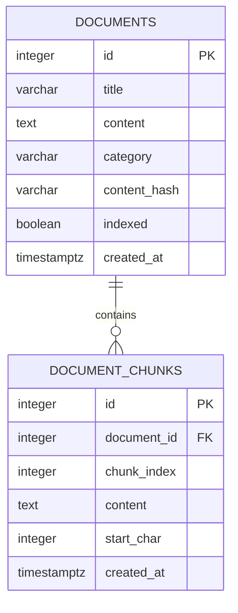

# Database Schema

## PostgreSQL relationships

## documents

| Column | Purpose |
|---|---|
| id | Generated document identifier |
| title | Document title |
| content | Original document text |
| category | general, hr, it, or finance; validated by the API |
| content_hash | SHA-256 content fingerprint used for duplicate detection |
| indexed | Whether indexing completed successfully |
| created_at | Creation timestamp |

The combination of category and content_hash is unique.

## document_chunks

| Column | Purpose |
|---|---|
| id | Generated chunk identifier, also used as the Qdrant point ID |
| document_id | Parent document identifier |
| chunk_index | Zero-based position within the document |
| content | Chunk text |
| start_char | Starting character offset; nullable for legacy rows |
| created_at | Creation timestamp |

The combination of document_id and chunk_index is unique.
chunk_index must be nonnegative.

Deleting a document cascades to its PostgreSQL chunks.
Qdrant cleanup is performed by application code.

## Qdrant collection

Default collection: rag_document_chunks

- One unnamed vector per chunk
- 1536 dimensions with the configured embedding model
- Cosine distance
- Point ID corresponds to the PostgreSQL chunk ID

Payload fields include:

- document_id
- chunk_index
- title
- content
- category
- start_char

Qdrant does not enforce the PostgreSQL foreign-key relationship.
The application coordinates indexing, reindexing, and deletion.